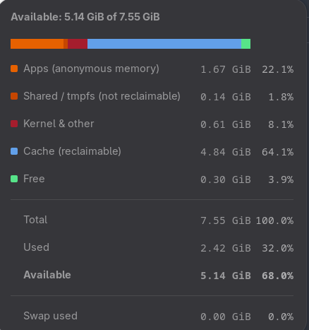
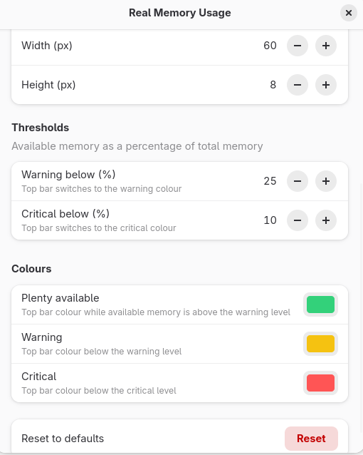

# Real Memory Usage

A GNOME Shell extension that shows how much memory is **really available** on the host,
which is useful on machines that start VMs (QEMU) and need to know how much RAM can still
be handed out.

The top bar shows `MemAvailable` from `/proc/meminfo`, the same value as the `available`
column of `free`, with a small stacked bar graph.


 The dropdown breaks memory down into:

| Segment             | Meaning                                                  |
| ------------------- | -------------------------------------------------------- |
| Apps                | anonymous memory (`AnonPages`)                           |
| Shared / tmpfs      | `Shmem`, not reclaimable (includes tmpfs such as `/tmp`) |
| Kernel & other      | the remainder of used memory                             |
| Cache (reclaimable) | page cache and reclaimable slab that can be dropped      |
| Free                | `MemFree`                                                |

`Used = MemTotal − MemAvailable`. Swap usage and free hugepages are listed below the totals.



## Settings

Right click the indicator to open the settings:

- refresh interval
- warning and critical thresholds (percent of total memory available) and their colours
- top bar graph: show or hide, position (before or after the text), width and height in pixels



## Install

### Install script

```
./install.sh
```

It packs and installs the extension using only `gnome-extensions`.

### Without `make` or the script (e.g. Fedora Silverblue)

The script runs these two commands. From the repository root:

```
gnome-extensions pack --force --out-dir=/tmp real-memory-usage@pg2web.github.io
gnome-extensions install --force /tmp/real-memory-usage@pg2web.github.io.shell-extension.zip
```

`pack` compiles the settings schema, so `glib-compile-schemas` is not needed.

### With `make`

```
make install
```

`make pack` builds a zip for upload to extensions.gnome.org.

### Enable

Log out and back in (required on Wayland), then:

```
gnome-extensions enable real-memory-usage@pg2web.github.io
```

After a code update, repeat the install and log out and back in again. A nested shell
(`dbus-run-session gnome-shell --devkit`) can be used to test changes without logging out.

Supported GNOME Shell versions: 48, 49, 50.

## License

GPL-2.0-or-later, see `LICENSE`.
